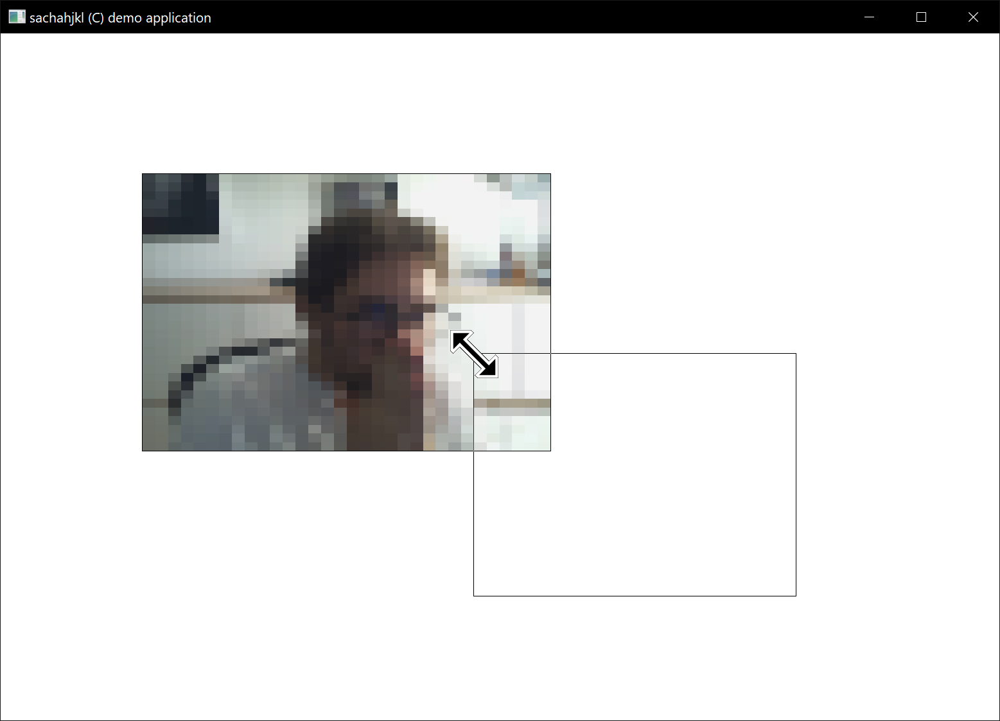

[English](README.md) | [Français](README.fr.md)

# Application de démonstration Win32

Cette application de démonstration est destinée à l'apprentissage.
C'est une application bitmap simple qui permet de dessiner un bitmap à l'écran et de le déplacer.
Le bitmap est chargé depuis un fichier de ressources. Vous pouvez le redimensionner en faisant glisser son coin inférieur droit.

## Fonctions actuelles

- Application bitmap simple
- Bitmap chargé depuis un fichier de ressources
- Bitmap redimensionnable par glissement et sélection d'une zone dans la fenêtre
- Bitmap déplaçable sur l'écran

## Prérequis

- Windows 10 ou version ultérieure. L'application fonctionne probablement sous Windows 7 et les versions antérieures, mais cela n'a pas été testé.
- Visual Studio 2022 ou version ultérieure. La compilation fonctionne probablement avec Visual Studio 2019 et les versions antérieures, mais cela n'a pas été testé.

## Utilisation

Pour exécuter l'application, lancez le script `build.bat` avec l'argument `release` ou `debug`.
Par exemple, exécutez `build.bat release` pour compiler l'application en mode release.
Le script crée un répertoire `build` à la racine du projet. Il compile ensuite l'application dans le répertoire `release`.

Pour lancer l'application, double-cliquez sur le fichier `app.exe` dans le répertoire `build`.
